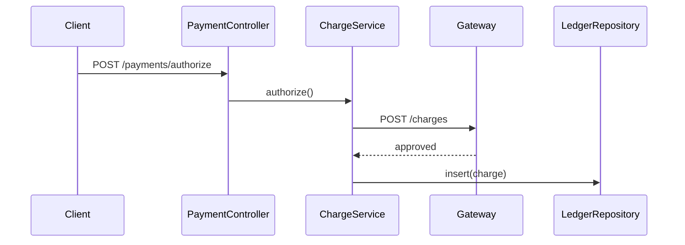

# Example: Authoring a Findings Doc for a Payment Area

**Scenario**: The questions for the `payment` area are confirmed and evidence is verified. Author the full `findings-payment.md` with orientation, topic blocks, and an evidence section.

**Applies**: **author-findings-doc**

## Input / Context

- Confirmed questions: responsibility, entry points, authorize flow, charge-to-ledger flow, retry config, circuit-breaker gap.
- Evidence: `PaymentController.java:41`, `ChargeService.java:88`, `RetryConfig.java:12` (no circuit-breaker match).

## Output

````markdown
<!-- findings-doc
area: payment
spike: checkout-reliability
status: complete
scope: card authorization, capture, and refund paths
related-areas: [orders]
-->

# Findings: Payment

## 1. Orientation

| Component | Purpose | Entry point | Key files |
|---|---|---|---|
| Payment API | Receives authorize/capture/refund requests | `PaymentController.java:41` | `PaymentController.java` |
| Charge service | Calls the gateway and records the ledger | `ChargeService.java:88` | `ChargeService.java`, `LedgerRepository.java` |
| Retry config | Sets retry attempts and backoff | `RetryConfig.java:12` | `RetryConfig.java` |

## 2. Where does a payment get authorized?

**TL;DR:** The controller forwards to the gateway, then writes the ledger.



**Key claims**
- Authorize enters at the controller — `PaymentController.java:41` ✅ Verified
- The gateway is called from `authorize()` — `ChargeService.java:88` ✅ Verified
- The ledger row is written after gateway approval — `LedgerRepository.java:57` ✅ Verified

## 3. How is retry configured for the charge call?

**TL;DR:** Three attempts with exponential backoff, no jitter.

**Key claims**
- Retry count is 3 — `RetryConfig.java:12` ✅ Verified
- Backoff is exponential — `RetryConfig.java:13` ✅ Verified
- No jitter is configured — `RetryConfig.java:14` ✅ Verified

## 4. Evidence & Verification

| Claim ID | Claim | Verdict | Evidence (file:line) | Confidence |
|---|---|---|---|---|
| payment/authorize-flow#c1 | Authorize enters at the controller | Yes | `PaymentController.java:41` | ✅ Verified |
| payment/authorize-flow#c2 | Gateway called in `authorize()` | Yes | `ChargeService.java:88` | ✅ Verified |
| payment/retry-config#c1 | Retry count is 3 | Yes | `RetryConfig.java:12` | ✅ Verified |

### Searched-negatives

| Search (pattern/query) | Result | Next step |
|---|---|---|
| `circuit.?breaker` in `payment/**` | No match | Investigate gateway client resilience |

### Coverage

| In-scope question | Investigated | Not investigated / Gaps |
|---|---|---|
| Circuit breaker on gateway | No | ❓ Not found |
````

**Result**:
- One doc per area, fixed section order, every claim with inline `file:line` and a ledger row.
- Saved to `spikes/checkout-reliability/docs/findings-payment.md`.
