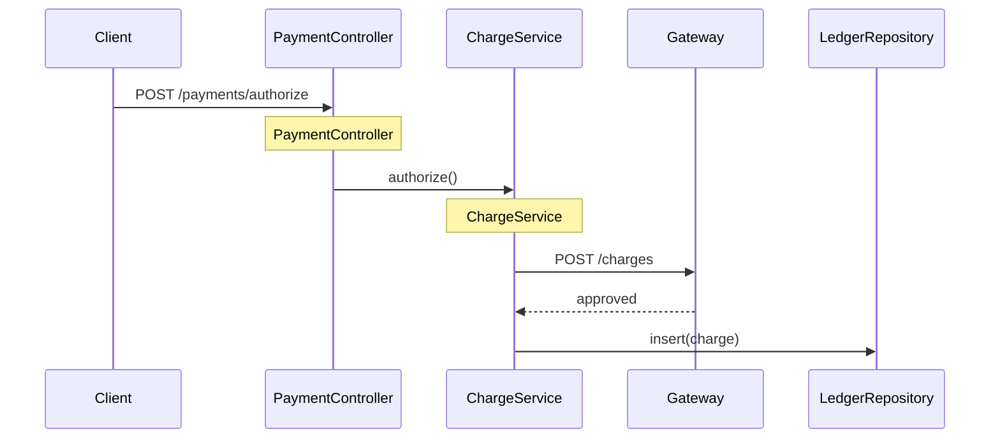
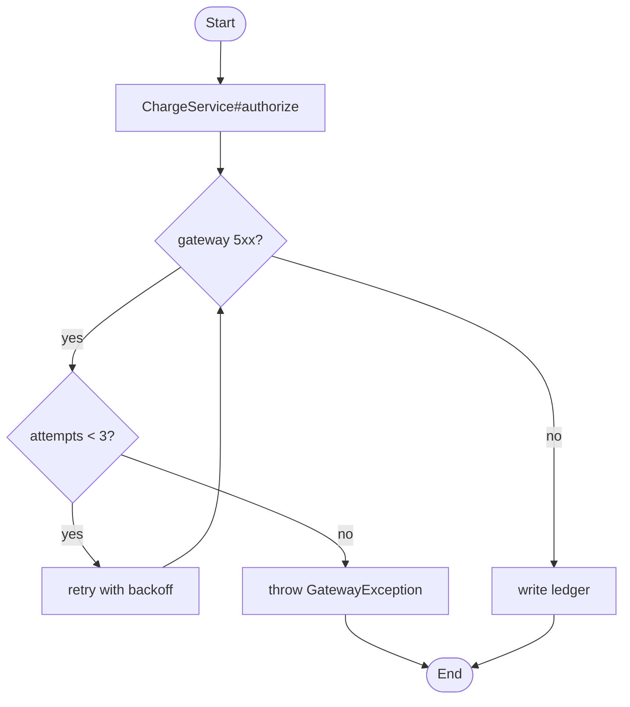

# Example: Authoring the Human Findings Doc for a Payment Area

**Scenario**: The `payment` area's questions and evidence are ready. Author the publishable `findings-payment.md` with frontmatter, summary, orientation, glossary, and topic blocks.

**Applies**: **author-findings-doc**

## Input / Context

- Confirmed questions: responsibility, entry points, authorize flow, failure behavior, retry config, circuit-breaker presence.
- Evidence: `PaymentController.java:41`, `ChargeService.java:88`, `RetryConfig.java:12` (no circuit-breaker match).

## Output

````markdown
---
title: Findings: Payment
area: payment
status: complete
---

# Findings: Payment

**Summary:** The payment area authorizes, captures, and refunds card payments. It alone writes the `ledger` table and calls the external gateway. Checkout and orders reach it via the Payment API.

## 1. Orientation

| Component | Purpose | Entry point | Key files |
|---|---|---|---|
| Payment API | Receives authorize/capture/refund requests | `PaymentController.java:41` | `PaymentController.java` |
| Charge service | Calls the gateway and records the ledger | `ChargeService.java:88` | `ChargeService.java`, `LedgerRepository.java` |
| Retry config | Sets retry attempts and backoff | `RetryConfig.java:12` | `RetryConfig.java` |

Start here: `PaymentController#authorize (PaymentController.java:41)`.

## 2. Glossary

| Term | Meaning |
|---|---|
| Authorize | Reserve funds on the card without capturing them |
| Capture | Take the reserved funds |
| Gateway | External card processor called over HTTP |
| Ledger | Internal table recording every charge and refund |

## 3. Where does a payment get authorized?

**TL;DR:** The controller forwards to the gateway, then writes the ledger.

> Happy path only; the failure branch is topic 4.



## 4. What happens when the gateway fails?

**TL;DR:** Three retries, then the call fails and no ledger row is written.



## 5. How is retry configured for the charge call?

**TL;DR:** Three attempts with exponential backoff, no jitter.

| Setting | Meaning | Value | Evidence (file:line) |
|---|---|---|---|
| `retry.attempts` | Number of retry attempts | 3 | `RetryConfig.java:12` |
| `retry.backoff` | Backoff between attempts | Exponential | `RetryConfig.java:13` |
| `retry.jitter` | Randomize backoff to avoid a thundering herd | Off | `RetryConfig.java:14` |

## 6. Is there a circuit breaker on the gateway call?

**TL;DR:** No breaker found; the gateway client has no resilience wrapper.

> Searched `payment/**` for a breaker; none found.
````

**Result**:
- Publishable: YAML frontmatter, no claim IDs, no confidence tags, no ledger.
- Every topic cites `<reference> (file:line)` for checking.
- Self-contained: no link to `evidence-payment.md`, so it publishes anywhere.
- Saved to `spikes/checkout-reliability/docs/findings-payment.md`.
