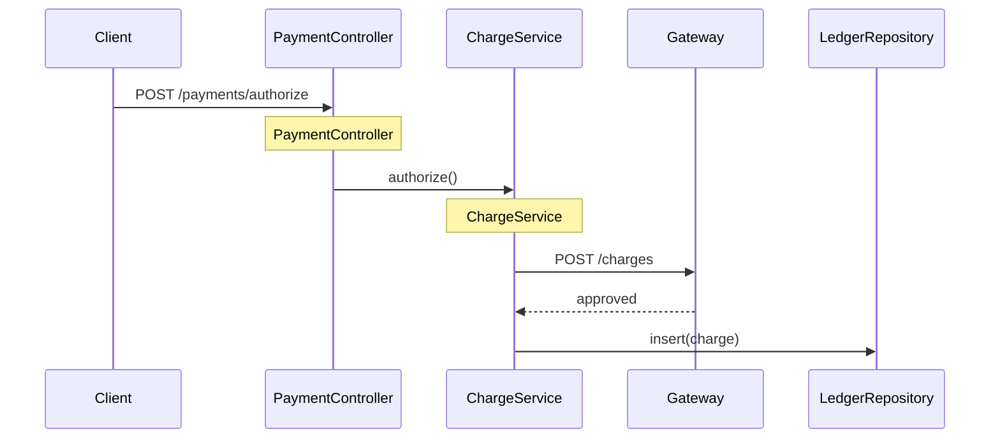
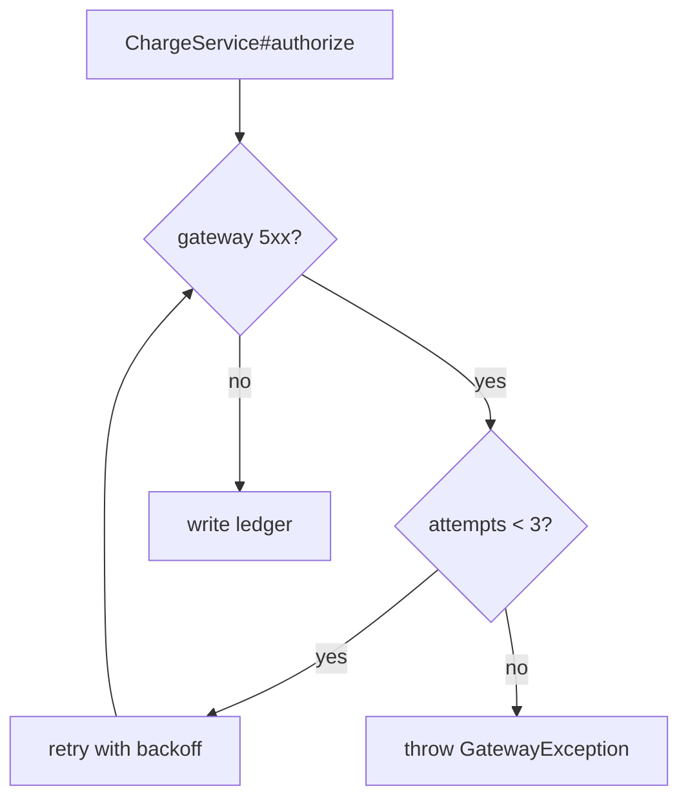

# Example: Authoring a Findings Doc for a Payment Area

**Scenario**: The `payment` area's questions and evidence are ready. Author the full `findings-payment.md` with summary, orientation, glossary, topic blocks, and evidence.

**Applies**: **author-findings-doc**

## Input / Context

- Confirmed questions: responsibility, entry points, authorize flow, failure behavior, retry config.
- Evidence: `PaymentController.java:41`, `ChargeService.java:88`, `RetryConfig.java:12` (no circuit-breaker match).

## Output

````markdown
<!-- findings-doc
area: payment
spike: checkout-reliability
status: complete
scope: card authorization, capture, and refund paths
related-areas: [orders]
-->

# Findings: Payment

**Summary:** The payment area authorizes, captures, and refunds card payments. It alone writes the `ledger` table and calls the external gateway. Checkout and orders reach it via the Payment API.

## 1. Orientation

| Component | Purpose | Entry point | Key files |
|---|---|---|---|
| Payment API | Receives authorize/capture/refund requests | `PaymentController.java:41` | `PaymentController.java` |
| Charge service | Calls the gateway and records the ledger | `ChargeService.java:88` | `ChargeService.java`, `LedgerRepository.java` |
| Retry config | Sets retry attempts and backoff | `RetryConfig.java:12` | `RetryConfig.java` |

Start here: `PaymentController#authorize (PaymentController.java:41)`.

## 2. Glossary

| Term | Meaning |
|---|---|
| Authorize | Reserve funds on the card without capturing them |
| Capture | Take the reserved funds |
| Gateway | External card processor called over HTTP |
| Ledger | Internal table recording every charge and refund |

## 3. Where does a payment get authorized? <!-- id: payment/authorize-flow -->

**TL;DR:** The controller forwards to the gateway, then writes the ledger.

> Happy path only; the failure branch is topic 4.



**Claims**
- Authorize enters at `PaymentController#authorize (PaymentController.java:41)` ✅ Verified
- The gateway is called from `ChargeService#authorize (ChargeService.java:88)` ✅ Verified
- The ledger row is written by `LedgerRepository#insert (LedgerRepository.java:57)` ✅ Verified

## 4. What happens when the gateway fails? <!-- id: payment/authorize-failure -->

**TL;DR:** Three retries, then the call fails and no ledger row is written.



**Claims**
- Retries up to 3 times — `RetryConfig#attempts (RetryConfig.java:12)` ✅ Verified
- No ledger row is written on failure — `ChargeService#authorize (ChargeService.java:96)` ✅ Verified

## 5. How is retry configured for the charge call? <!-- id: payment/retry-config -->

**TL;DR:** Three attempts with exponential backoff, no jitter.

| Setting | Meaning | Value | Evidence (file:line) |
|---|---|---|---|
| `retry.attempts` | Number of retry attempts | 3 | `RetryConfig.java:12` |
| `retry.backoff` | Backoff between attempts | Exponential | `RetryConfig.java:13` |
| `retry.jitter` | Randomize backoff to avoid a thundering herd | Off | `RetryConfig.java:14` |

## 6. Evidence & Verification

| Claim ID | Claim | Verdict | Evidence (file:line) | Confidence |
|---|---|---|---|---|
| payment/authorize-flow#c1 | Authorize enters at the controller | Yes | `PaymentController.java:41` | ✅ Verified |
| payment/authorize-flow#c2 | Gateway called in `authorize()` | Yes | `ChargeService.java:88` | ✅ Verified |
| payment/authorize-flow#c3 | Ledger row written after approval | Yes | `LedgerRepository.java:57` | ✅ Verified |
| payment/authorize-failure#c1 | Retries up to three times | Yes | `RetryConfig.java:12` | ✅ Verified |
| payment/authorize-failure#c2 | No ledger row written on failure | Yes | `ChargeService.java:96` | ✅ Verified |

### Searched-negatives

| Search (pattern/query) | Result | Next step |
|---|---|---|
| `circuit.?breaker` in `payment/**` | No match | Investigate gateway client resilience |

### Coverage

| In-scope question | Investigated | Not investigated / Gaps |
|---|---|---|
| Circuit breaker on gateway | No | ❓ Not found |
````

**Result**:
- Human on-ramp: a `**Summary:**`, a Glossary, and a "Start here" pointer.
- Every claim cites `<reference> (file:line)`; the ledger keeps bare `file:line`.
- The happy-path diagram states its assumption; the failure path is its own topic.
- Saved to `spikes/checkout-reliability/docs/findings-payment.md`.
