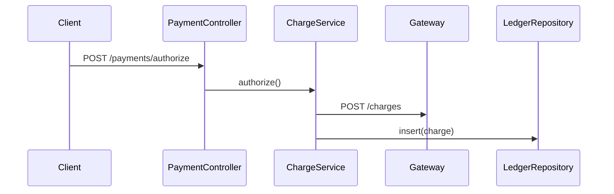

# Example: Splitting a Combined Findings Doc

**Scenario**: A legacy `findings-payment.md` mixes reader narrative with claim IDs, confidence tags, and an Evidence ledger. Split it into a publishable human doc and the machine evidence doc.

**Applies**: **split-findings-doc**

## Input / Context

The legacy combined `findings-payment.md` holds:
- Summary, Orientation, Glossary, topic blocks, and a filled Evidence & Verification section.
- Existing IDs: `payment/authorize-flow#c1`–`#c3`, `payment/retry-config#c1`, plus one unnumbered retry claim.
- Inline `file:line` anchors across the topics.

## Output

**Step 2 — human doc `findings-payment.md`** (narrative kept, machine layer removed, topics 3 and 5 shown):

````markdown
---
title: Findings: Payment
area: payment
status: complete
---

# Findings: Payment

**Summary:** The payment area authorizes, captures, and refunds card payments.

## 3. Where does a payment get authorized?

**TL;DR:** The controller forwards to the gateway, then writes the ledger.



## 5. How is retry configured for the charge call?

**TL;DR:** Three attempts with exponential backoff, no jitter.

| Setting | Meaning | Value | Evidence (file:line) |
|---|---|---|---|
| `retry.attempts` | Number of retry attempts | 3 | `RetryConfig.java:12` |
| `retry.jitter` | Randomize backoff to avoid a thundering herd | Off | `RetryConfig.java:14` |
````

**Step 3 — evidence doc `evidence-payment.md`**:

```markdown
<!-- evidence-doc
area: payment
spike: checkout-reliability
status: complete
scope: card authorization, capture, and refund paths
related-areas: [orders]
human-doc: docs/findings-payment.md
-->

# Evidence: Payment

## 1. Topic map

| Topic slug | Human heading | Claim IDs |
|---|---|---|
| payment/authorize-flow | findings-payment.md#3-where-does-a-payment-get-authorized | #c1, #c2, #c3 |
| payment/retry-config | findings-payment.md#5-how-is-retry-configured-for-the-charge-call | #c1, #c2 |

## 2. Claim ledger

| Claim ID | Claim | Verdict | Evidence (file:line) | Confidence |
|---|---|---|---|---|
| payment/authorize-flow#c1 | Authorize enters at the controller | Yes | `PaymentController.java:41` | ✅ Verified |
| payment/authorize-flow#c2 | Gateway called in `authorize()` | Yes | `ChargeService.java:88` | ✅ Verified |
| payment/authorize-flow#c3 | Ledger row written after approval | Yes | `LedgerRepository.java:57` | ✅ Verified |
| payment/retry-config#c1 | Retry count is 3 | Yes | `RetryConfig.java:12` | ✅ Verified |
| payment/retry-config#c2 | No jitter configured | Yes | `RetryConfig.java:14` | ✅ Verified |

## 5. Cross-area references

| Constraint | This area | Related area | Evidence (file:line) |
|---|---|---|---|
| Ledger ownership | `payment` writes `ledger` | `orders` reads it | `LedgerRepository.java:57` |
```

**Result**:
- IDs `authorize-flow#c1`–`#c3` and `retry-config#c1` are preserved, and the unnumbered claim took `retry-config#c2`.
- The human doc keeps its narrative, inline anchors, and heading anchors, with no claim IDs, confidence tags, or evidence-doc link.
- The evidence doc names the human doc and links each topic to its heading.
