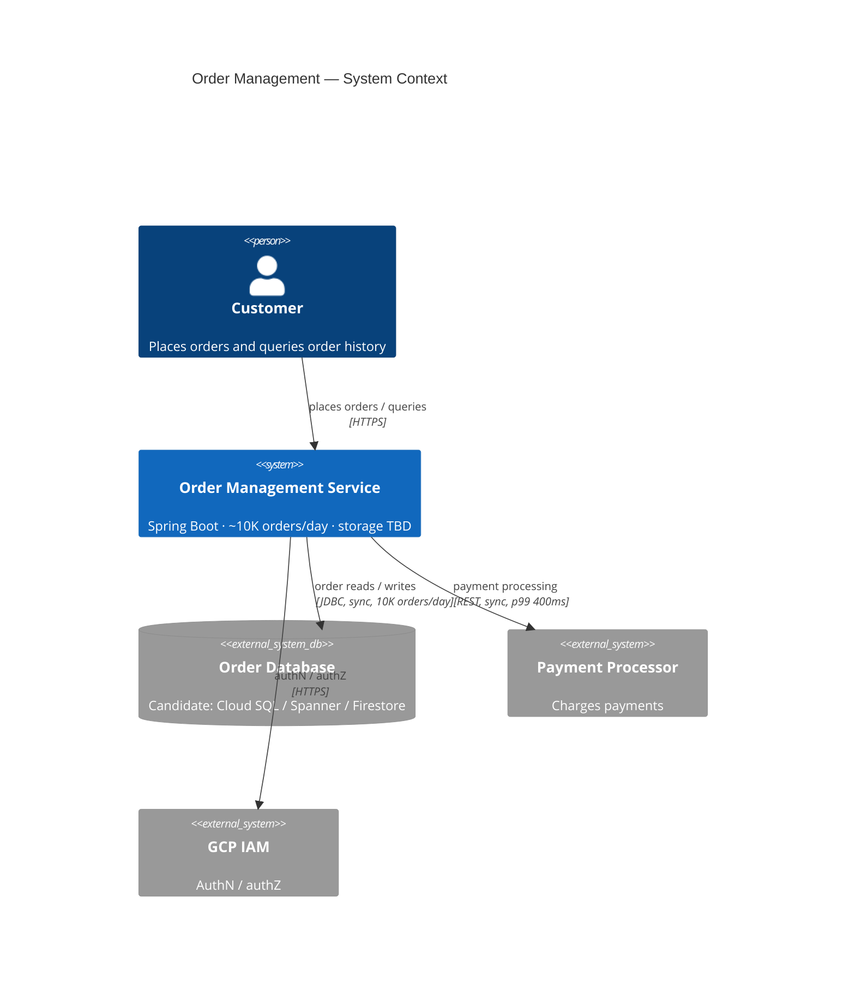
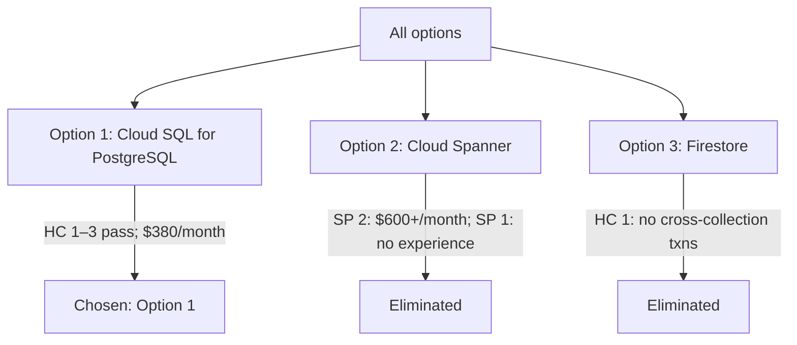

# Example: Database Selection for a New Microservice — Walkthrough

**Scenario**: The user is choosing a database for a new order-management microservice and wants a structured walkthrough. Demonstrates **define-problem** → **define-decision-drivers** → **define-considered-options** → **evaluate-options** → **compile-adr**. The service does not exist yet, so **detail-options-tech** takes its no-code branch.

**Companion**: the compiled ADR this walkthrough produces is in [database-selection-adr.md](database-selection-adr.md).

---

## Capability: define-problem

**User input**:
> We're building a new order-management microservice handling ~10K orders/day. We need to pick a database. It needs complex queries on order history, ACID transactions for payment, and it'll run on GCP.

**Agent output**:
> **Problem Statement**: Select a database for a new order-management microservice on GCP supporting ~10,000 orders/day, complex order-history queries, and ACID payment transactions.
>
> Does this accurately capture the problem?

**User confirms**: Yes.

**Agent output**:
> Here's the system context, with volumes and protocols:

---

## Capability: define-decision-drivers

**User input**:
> Team knows PostgreSQL well, infra costs must stay low, order lookups under 100ms, and we're on GCP so managed services are preferred.

**Agent output**:
> Each driver gets a metric, a threshold, and a measurement:

| Tag | Driver | Threshold | Measured by |
|---|---|---|---|
| `HC 1` | ACID transactions on payment writes | 100% of payment writes roll back atomically | 2-connection rollback test |
| `HC 2` | Order lookup latency | p99 < 100ms at 10K orders/day | Load test on seeded history |
| `HC 3` | GCP integration | Managed service reachable from the VPC | Private-IP connect check |
| `SP 1` | Team PostgreSQL expertise | No training before launch | 4 of 6 engineers use it daily |
| `SP 2` | Infrastructure cost | ≤ $400/month at current volume | GCP invoiced cost |
| `SP 3` | Managed operations | Patching and backups handled by GCP | Provider feature list |

> Would you like to reorder or adjust these?

**User confirms**: Looks good.

---

## Capability: define-considered-options

**User input**:
> We're thinking Cloud SQL (PostgreSQL), but should we consider others?

**Agent output**:
> Brainstorming alternatives: **industry-standard** — Cloud Spanner, Firestore; **build vs. buy** — all managed, no build option; **incremental vs. big-bang** — start simple, migrate later.
>
> Proposed options — each names a distinct mechanism:
>
> - Option 1: Cloud SQL for PostgreSQL — managed single-node relational DB
> - Option 2: Cloud Spanner — globally sharded relational DB
> - Option 3: Firestore — serverless document store, per-document transactions
>
> Do these three cover the viable options?

**User confirms**: These three are good.

---

## Capability: evaluate-options

**Option 1: Cloud SQL for PostgreSQL**

**User input**:
> Pros: team knows it, full ACID, flexible queries. Cons: read replicas at scale, connection limits.

**Agent output**:
> The card is presented with its driver-impact and concerns tables; the verdict:

| Driver | Mark | Measured value | Evidence | Confidence |
|---|---|---|---|---|
| `HC 1` ACID payment writes | ✅ | Full transaction support | PostgreSQL docs, rollback test | verified |
| `HC 2` p99 < 100ms | ✅ | p99 40ms on 1M seeded orders | Load test 2026-07-02 | verified |
| `HC 3` GCP integration | ✅ | Native private-IP managed service | GCP console | verified |
| `SP 1` PostgreSQL expertise | ✅ | 4 of 6 engineers use it daily | Team survey | verified |
| `SP 2` ≤ $400/month | ⚠️ | $380/month, db-custom-2-7680 | GCP pricing calculator | inferred |
| `SP 3` Managed operations | ✅ | Automated backups and patching | Provider feature list | verified |

> **Verdict:** Recommended — satisfies all three hard constraints.
>
> Does this evaluation look accurate?

**User confirms**: Yes.

**Options 2 and 3** use the same card pattern; key results:
- **Option 2: Cloud Spanner** — all hard constraints ✅; **fails** `SP 1` (zero experience) and `SP 2` ($600+/month).
- **Option 3: Firestore** — `HC 2` ✅, `SP 2` ✅; **fails** `HC 1` (no cross-collection transactions).

**Agent output (after all options evaluated)**:
> | Driver | Option 1: Cloud SQL (PG) | Option 2: Cloud Spanner | Option 3: Firestore |
> |---|---|---|---|
> | `HC 1` ACID payment writes | ✅ full transactions | ✅ full transactions | ❌ no cross-collection txns |
> | `HC 2` p99 < 100ms | ✅ 40ms | ✅ 38ms | ✅ 55ms |
> | `HC 3` GCP integration | ✅ native | ✅ native | ✅ native |
> | `SP 1` PostgreSQL expertise | ✅ 4 of 6 | ❌ none | ⚠️ partial |
> | `SP 2` ≤ $400/month | ⚠️ $380 | ❌ $600+ | ✅ $120 |
> | `SP 3` Managed operations | ✅ | ✅ | ✅ |
>
> Option 3 is eliminated by `HC 1`; Option 2 fails `SP 1` and `SP 2`. Option 1 satisfies all hard constraints and 2 of 3 soft preferences.
>
> **detail-options-tech (no-code branch):** no service exists yet, so there is no evidence map. The change set is architectural — `C1`–`C3`, every location `unverified`.
>
> **Given the evaluations, which option best satisfies the decision drivers?**

**User confirms**: Option 1.

---

## Capability: compile-adr

**Agent output**:
> Metadata: title, owners, and status?

**User input**:
> "Database Selection for Order-Management Service"; Alice (Tech Lead); draft.

**Agent loads reference/adr-template.md, populates it, orders `C1`–`C3` into the Implementation Plan, then loads reference/adr-quality-checklist.md and passes every item.**

**Agent output**:
> The compiled ADR is in [database-selection-adr.md](database-selection-adr.md). Would you like to adjust any section before saving?
