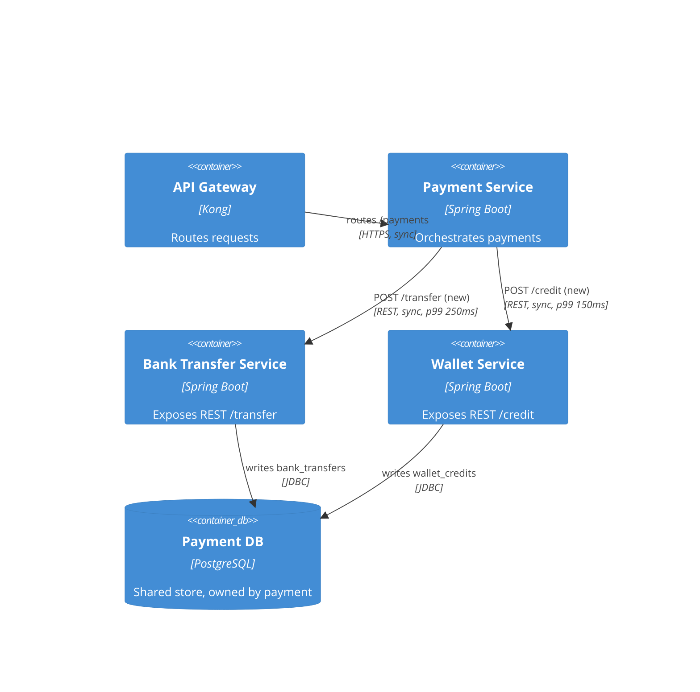
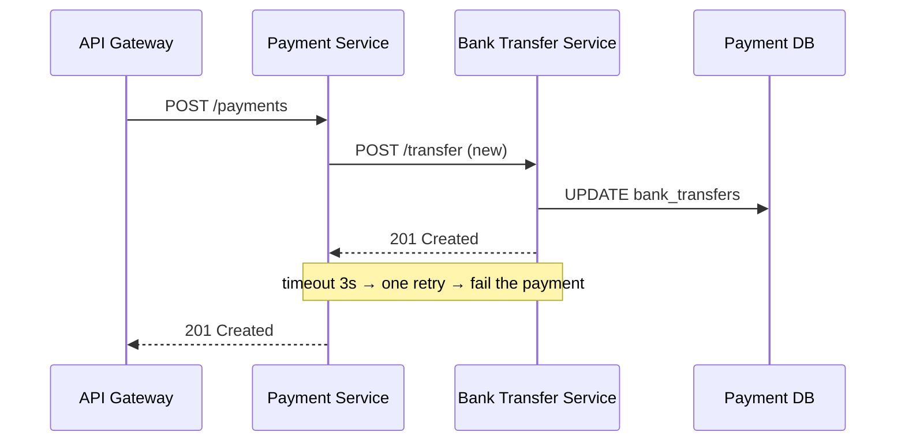
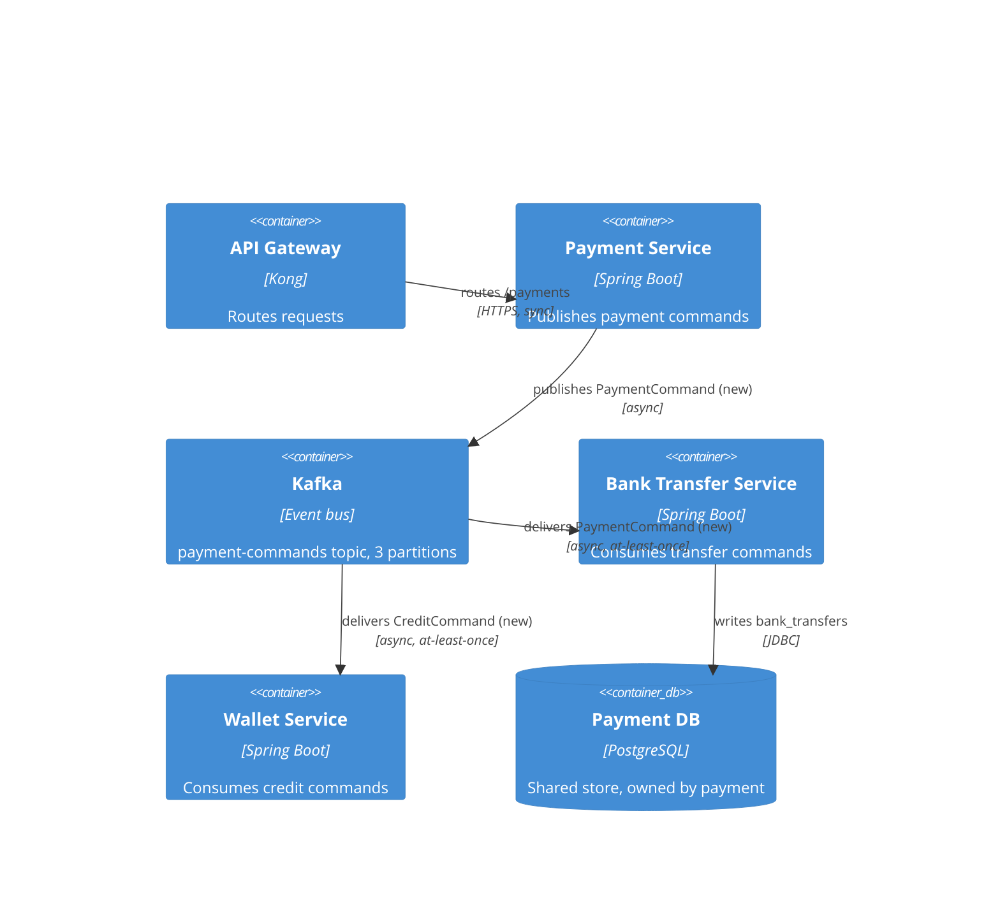
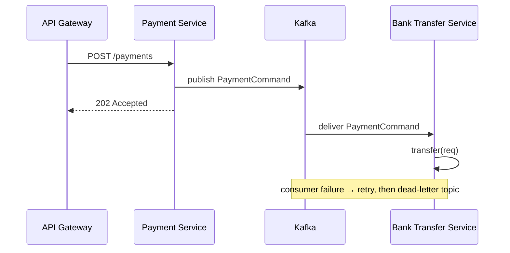

# Example: Tech Details Per Option — Inter-Service Communication

**Scenario**: Drafting the "Inter-service communication" ADR from a payment-monolith spike; **detail-options-tech** renders each option's target state and grounded change set before the user chooses.

**Applies**: `detail-options-tech` (inside `evaluate-options`), rendered by `compile-adr`.

---

## Input / Context

**Options**: 1 Synchronous REST (HTTP calls), 2 Async events (Kafka), 3 Hybrid (REST queries, event commands).

### Evidence map (from the spike)

| Location | Symbol | Role |
|---|---|---|
| `PaymentOrchestrator.java:142` | `processPayment(Order)` | In-process calls to bank transfer + wallet credit |
| `BankTransferService.java:88` | `transfer(TransferRequest)` | Bank-transfer DB writes |
| `WalletService.java:120` | `credit(WalletCredit)` | Wallet-credit DB writes |

Current state: one monolith; `PaymentOrchestrator` calls both services in-process against one `Payment DB`.

---

## Expected output

### Option 1: Synchronous REST

#### Tech Details



| Delta | Element |
|---|---|
| `NEW` | REST endpoints on `BankTransferService`, `WalletService` |
| `CHANGED` | `PaymentOrchestrator` — in-process calls become HTTP calls |



**Code changes:**

1. **`C1` — `BankTransferService.java:88` `transfer(TransferRequest)`** (verified)
   - Current: plain method `public void transfer(TransferRequest req)`, called only in-process.
   - Diff:
     ```diff
     diff --git a/src/main/java/com/pay/BankTransferService.java b/src/main/java/com/pay/BankTransferService.java
     --- a/src/main/java/com/pay/BankTransferService.java
     +++ b/src/main/java/com/pay/BankTransferService.java
     @@ -1,2 +1,4 @@
     +@RestController
     +@RequestMapping("/transfer")
      @Service
      public class BankTransferService {
     @@ -88,5 +92,10 @@ public class BankTransferService {
       public void transfer(TransferRequest req) {
         validate(req);
         bankTransferRepository.save(req);
       }
     +
     +  @PostMapping
     +  public void transferEndpoint(@RequestBody TransferRequest req) {
     +    transfer(req);
     +  }
      }
     ```
   - How: annotate the class, add a thin REST wrapper delegating to `transfer`.

2. **`C2` — `PaymentOrchestrator.java:142` `processPayment(Order)`** (verified)
   - Current: `bankTransferService.transfer(req)` — direct in-process call.
   - Diff:
     ```diff
     diff --git a/src/main/java/com/pay/PaymentOrchestrator.java b/src/main/java/com/pay/PaymentOrchestrator.java
     --- a/src/main/java/com/pay/PaymentOrchestrator.java
     +++ b/src/main/java/com/pay/PaymentOrchestrator.java
     @@ -142,1 +142,1 @@ public class PaymentOrchestrator {
     -    bankTransferService.transfer(req);
     +    restTemplate.postForObject(btUrl + "/transfer", req, Void.class);
     ```
   - How: replace the in-process call with a REST client call to the configured service URL.

3. **`C3` — `application.yml:52` `payment.services`** (inferred: shape read, new value)
   - Current: block exists with no bank-transfer URL.
   - Diff:
     ```diff
     diff --git a/src/main/resources/application.yml b/src/main/resources/application.yml
     --- a/src/main/resources/application.yml
     +++ b/src/main/resources/application.yml
     @@ -52,2 +52,3 @@ payment:
       services:
     +    bank-transfer: http://bank-transfer:8080
     ```
   - How: add the URL under the existing `payment.services` block.

**New files:** none.

**Config / dependencies:** covered by `C3`; `spring-web` already in `pom.xml:21` (verified).

**Tests affected:** add `PaymentOrchestratorIT` asserting the HTTP hop.

**Data changes:** none.

---

### Option 2: Async events (Kafka)

#### Tech Details



| `CHANGED` | `PaymentOrchestrator` — in-process calls become publishes |
| `NEW` | Kafka cluster, `payment-commands` topic, two consumers |



**Code changes:**

1. **`C1` — `pom.xml:21` dependencies** (verified: no Kafka present)
   - Diff:
     ```diff
     diff --git a/pom.xml b/pom.xml
     --- a/pom.xml
     +++ b/pom.xml
     @@ -21,4 +21,8 @@
       <dependency>
         <groupId>org.springframework.boot</groupId>
         <artifactId>spring-boot-starter-web</artifactId>
       </dependency>
     +  <dependency>
     +    <groupId>org.springframework.kafka</groupId>
     +    <artifactId>spring-kafka</artifactId>
     +  </dependency>
     ```
   - How: add the Spring Kafka starter dependency.

2. **`C2` — `PaymentOrchestrator.java:142` `processPayment(Order)`** (verified)
   - Current: `bankTransferService.transfer(req)` — direct in-process call.
   - Diff:
     ```diff
     diff --git a/src/main/java/com/pay/PaymentOrchestrator.java b/src/main/java/com/pay/PaymentOrchestrator.java
     --- a/src/main/java/com/pay/PaymentOrchestrator.java
     +++ b/src/main/java/com/pay/PaymentOrchestrator.java
     @@ -142,1 +142,1 @@ public class PaymentOrchestrator {
     -    bankTransferService.transfer(req);
     +    kafkaTemplate.send("payment-commands", new PaymentCommand(order));
     ```
   - How: publish a command event; the response becomes `202 Accepted`.

3. **`C3` — `BankTransferService.java:88` `transfer(TransferRequest)`** (verified)
   - Diff:
     ```diff
     diff --git a/src/main/java/com/pay/BankTransferService.java b/src/main/java/com/pay/BankTransferService.java
     --- a/src/main/java/com/pay/BankTransferService.java
     +++ b/src/main/java/com/pay/BankTransferService.java
     @@ -88,5 +88,10 @@ public class BankTransferService {
       public void transfer(TransferRequest req) {
         validate(req);
         bankTransferRepository.save(req);
       }
     +
     +  @KafkaListener(topics = "payment-commands")
     +  public void onPaymentCommand(PaymentCommand cmd) {
     +    transfer(cmd.toRequest());
     +  }
      }
     ```
   - How: add a listener that delegates to the existing `transfer`.

4. **`C4` — `application.yml:10` `spring` block** (inferred: shape read, new key)
   - Current: the `spring` block carries `application.name` only.
   - Diff:
     ```diff
     diff --git a/src/main/resources/application.yml b/src/main/resources/application.yml
     --- a/src/main/resources/application.yml
     +++ b/src/main/resources/application.yml
     @@ -10,2 +10,4 @@ spring:
        application:
          name: payment-service
     +  kafka:
     +    bootstrap-servers: kafka:9092
     ```
   - How: add the broker address under the existing `spring` block.

**New files:** `PaymentCommand` DTO — **unverified**, flagged for follow-up.

**Config / dependencies:** covered by `C1` (starter) and `C4` (config key).

**Tests affected:** add a consumer test and a dead-letter assertion.

**Data changes:** none.

*(Option 3: Hybrid omitted — it composes the two shapes above.)*
