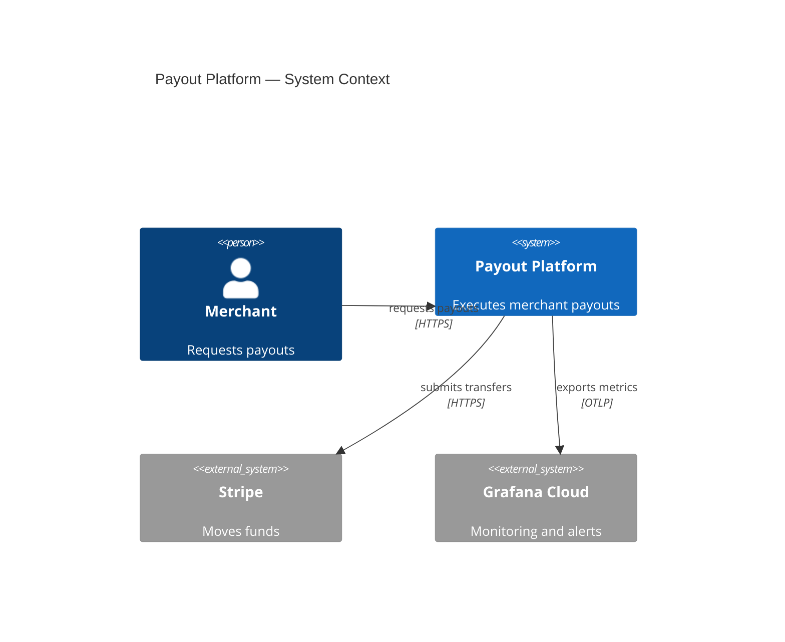
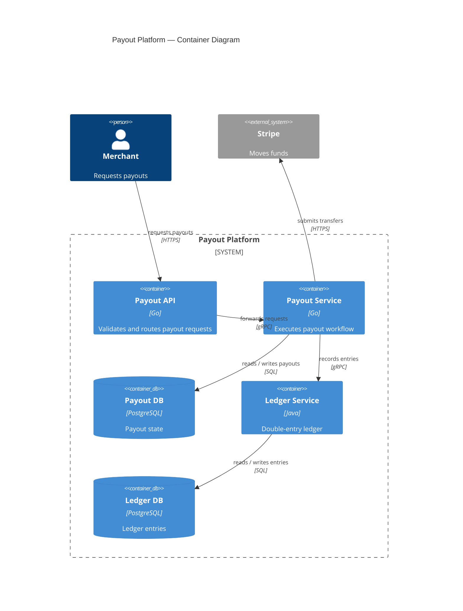
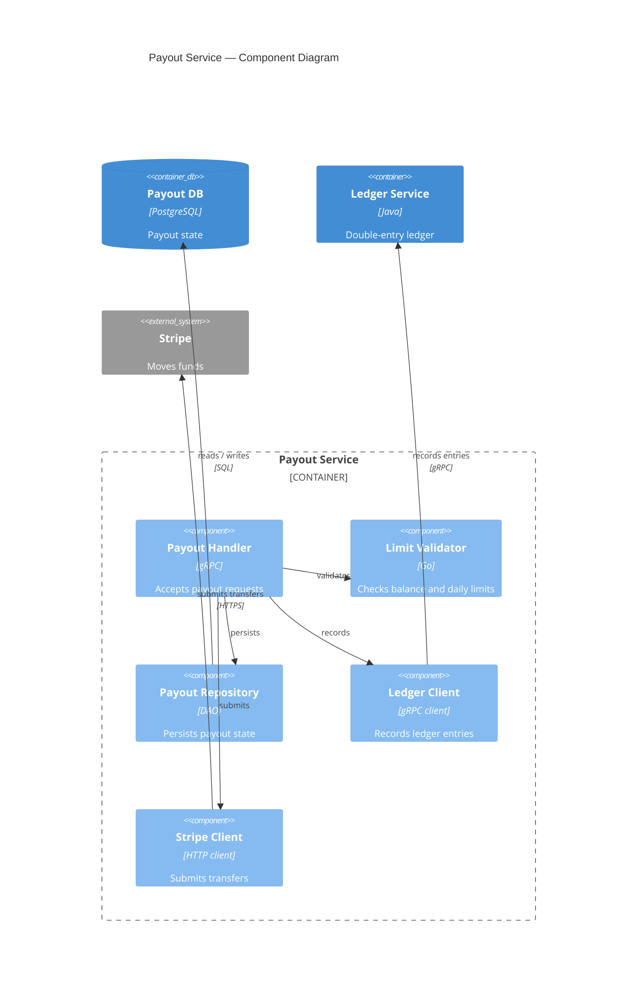

# Example: Drawing a C4 Context, Container, and Component Set

**Scenario**: The request fixes a three-level C4 set — context, containers, components — and the user has confirmed the facts.

**Applies** **author-mermaid-diagram**.

---

## Input

> "We run a payouts platform. Merchants call our Payout API.
> Inside, a Payout Service validates requests, then writes to Postgres and calls Stripe.
> A Ledger Service records every entry in its own Postgres. Ops watch everything through Grafana.
> Can you show me how this fits together?"

## Requested set

The request asks for C1 → C2 → C3, one message per level.

| Level | Message |
|---|---|
| C1 context | Who interacts with the platform, and what is in scope |
| C2 container | Which applications and stores compose the platform |
| C3 component | Which components live inside the Payout Service |

**Announced to the user**:
> Three levels, one message each — context, containers, then the Payout Service internals.

## C4 context (C1)



> **Takeaway**: Merchants reach one platform that delegates fund movement to Stripe and exports telemetry to Grafana.

## C4 container (C2)



> **Takeaway**: Two services and two stores; only the Payout Service talks to Stripe, and every payout reaches the ledger.

## C4 component (C3)



> **Takeaway**: The handler orchestrates four collaborators; only the repository owns SQL and only one client owns each external call.

## Validation

```
$ mmdc -i docs/payouts.md -o /tmp/check.md && echo "3 of 3 parsed"
3 of 3 parsed
```

- One level per diagram; each level shows only its own elements.
- Externals carry `_Ext`; every `Rel` names a flow and a protocol.
- Each level shows only its own elements; no container or component leaks up a level.
