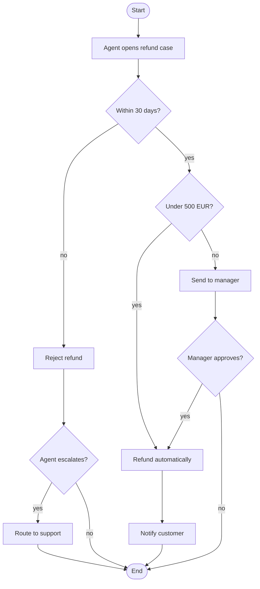
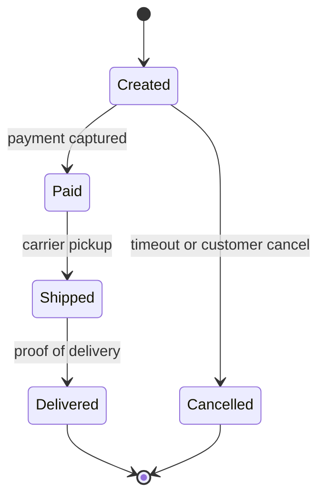

# Example: Drawing a Flowchart and a State Diagram

**Scenario**: The request needs the refund decision logic and the order lifecycle. The user supplies both as prose paragraphs.

**Applies** **author-mermaid-diagram**.

---

## Input

> "Refunds: an agent opens the case, we check whether the order is within 30 days and under 500 EUR.
> If both pass, refund automatically. If it is over 500 EUR, send it to a manager.
> If it is past 30 days, reject it but let the agent escalate to support.
> Lifecycle: orders start as Created, then either Paid or Cancelled; Paid moves to Shipped, then Delivered.
> Cancelled and Delivered are final."

## Types fixed by the request

- Refund rules → `flowchart`: branches and conditions decide the path.
- Order lifecycle → `stateDiagram-v2`: states and triggers, no process steps.

**Announced to the user**:
> Two diagrams: a flowchart for the refund rules, a state diagram for the order lifecycle. Neither carries the other's message.

## Flowchart



> **Takeaway**: Two gates decide automation — 30 days and 500 EUR — and every rejection path still leaves the agent an escalation route.

## State diagram



> **Takeaway**: Only Created branches; every later state has exactly one forward trigger.

## Validation

```
$ mmdc -i docs/solution-refunds.md -o /tmp/check.md && echo "2 of 2 parsed"
2 of 2 parsed
```

## Checks the parser cannot judge

- [x] Flowchart starts and ends at stadium nodes.
- [x] Every decision branch is labelled with its condition.
- [x] State transitions carry triggers; initial and final states are explicit.
- [x] Lifecycle stays in the state diagram; decision logic stays in the flowchart.
