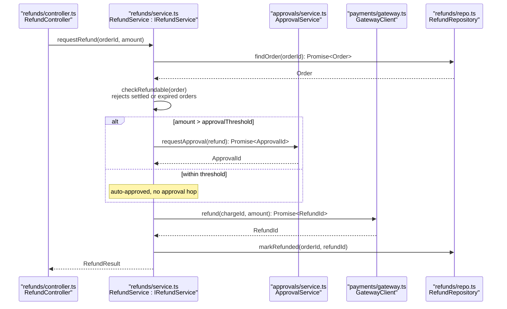

# Example: Drawing a Code-Level Sequence Diagram

**Scenario**: A code investigation found that refunds bypass the approval service. The user asks for a diagram of the actual refund path, and the code is accessible.

**Applies** **author-mermaid-diagram** for `sequenceDiagram`.

---

## Input

> "Show me what actually happens when a refund is requested. It crosses the refund controller, the refund service, and the gateway client — and I think it skips approval."

## Type and level (fixed by the request)

- Message: the order and timing of calls across three files.
- Type: `sequenceDiagram` at code level (cross-file / class).
- Zoom: one level only — no container hops on the same canvas.

**Announced to the user**:
> Code-level sequence, cross-file. Lifelines carry file paths; messages carry the real signatures.

## author-mermaid-diagram

1. Syntax reference loaded: `reference/sequence-syntax.md`.
2. Level declared in a `%%` comment and in the takeaway.
3. Participants named with file paths and interfaces.
4. Messages are real signatures; the self-call explains its effect.
5. Every call in the story appears once; one `alt` block carries the only branch.



> **Takeaway**: Approval is skipped under the threshold — the branch, not the prose, shows where refunds bypass the approval service.

## Validation

```
$ mmdc -i docs/findings-refunds.md -o /tmp/check.md && echo "1 of 1 parsed"
1 of 1 parsed
```

## Checks the parser cannot judge

- [x] One message: the refund path, not the whole payments area.
- [x] One zoom level: cross-file / class only.
- [x] Participants traceable: every lifeline names a file and a symbol.
- [x] Messages are contracts: signatures, not prose.
- [x] Self-call carries its effect (`rejects settled or expired orders`).
- [x] Takeaway names the finding, not the diagram structure.
