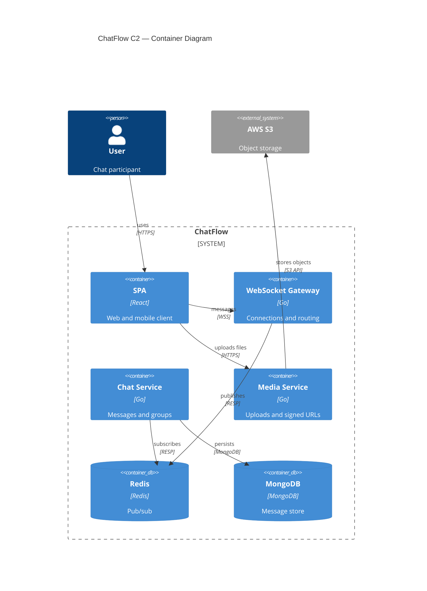

# Example: Syncing a Diagram Set After a Correction

**Scenario**: A solution document for a media platform has four diagrams. Mid-review the user announces a dedicated Media Service and a new upload flow. Only some diagrams are affected.

**Applies** **sync-diagram-set**.

---

## Input

> "Correction: uploads no longer pass through the Chat Service. We added a Media Service that stores to S3 and returns signed URLs. Please update the diagrams."

## Step 1 — inventory the set

```
$ python3 scripts/mermaid_blocks.py list docs/solution-chatflow.md
 1  docs/solution-chatflow.md:29  C4Container  (9 unit(s))  ChatFlow C2 — Container Diagram  #94616374
 2  docs/solution-chatflow.md:71  C4Component  (7 unit(s))  Chat Service — Component Diagram  #b2710e4c
 3  docs/solution-chatflow.md:104 sequenceDiagram  (5 unit(s))  -  #0d9f7a21
 4  docs/solution-chatflow.md:140 flowchart  (8 unit(s))  -  #44c8e1b7
```

## Step 2 — map the change to depicted elements

| Diagram | Depicts uploads? | Verdict |
|---|---|---|
| 1 C2 container | Yes — SPA → Chat Service → S3 | Affected: add Media Service, reroute |
| 2 C3 Chat Service | Yes — `s3_client` component | Affected: remove the S3 client |
| 3 Send DM sequence | No — no upload messages | Unaffected |
| 4 Moderation flowchart | No — moderation only | Unaffected |

## Step 3 — edit in place, preserving identity

The C2 keeps its title stem, aliases, and boundary; only the upload path changes.

**Delta stated before the block**:
> Updated: added the Media Service container; uploads now flow SPA → Media Service → S3, and the Chat Service no longer owns S3.



## Step 4 — replace the block through the tool

Select by title (or by `--hash` when the diagram has no title), never by index — indexes drift.

```
$ python3 scripts/mermaid_blocks.py replace docs/solution-chatflow.md \
    --title "ChatFlow C2 — Container Diagram" --from media-c2.mmd --check
docs/solution-chatflow.md: block 1 (C4Container, ChatFlow C2 — Container Diagram) at line 29
-         Container(chat_svc, "Chat Service", "Go", "Messages and groups")
+         Container(media_svc, "Media Service", "Go", "Uploads and signed URLs")
...
$ python3 scripts/mermaid_blocks.py replace docs/solution-chatflow.md \
    --title "ChatFlow C2 — Container Diagram" --from media-c2.mmd
replaced block 1 (C4Container, ChatFlow C2 — Container Diagram) at line 29
```

The second affected diagram loses one component and one relationship — same selector, its own title.

## Step 5 — cross-check the set

- [x] Every confirmed fact appears: Media Service in C2, upload path in C2, no `s3_client` left in C3.
- [x] No diagram contradicts the latest state.
- [x] No stale copy of the old upload path remains.
- [x] New context? None — the correction changed an existing path, so no diagram was added.
- [x] Block 1 keeps its title, aliases, and boundary.
- [x] Block 2 keeps its title and component aliases.

## Step 6 — validate and report

```
$ mmdc -i docs/solution-chatflow.md -o /tmp/check.md && echo "4 of 4 parsed"
4 of 4 parsed
```

> Updated diagrams 1 and 2 (upload path, S3 client); diagrams 3 and 4 unchanged; 0 errors remain.
