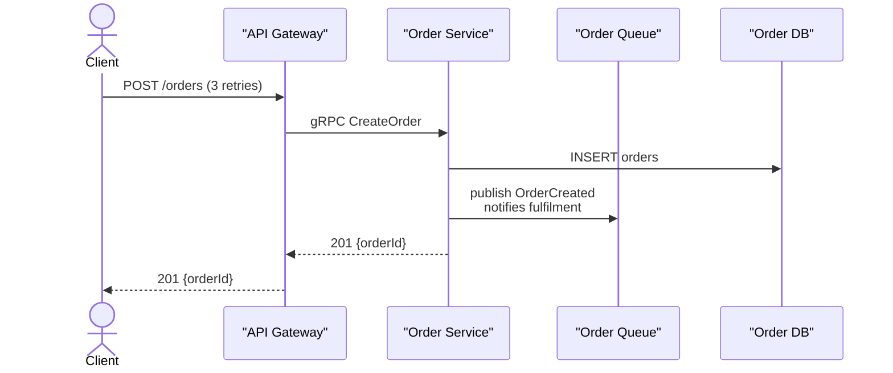
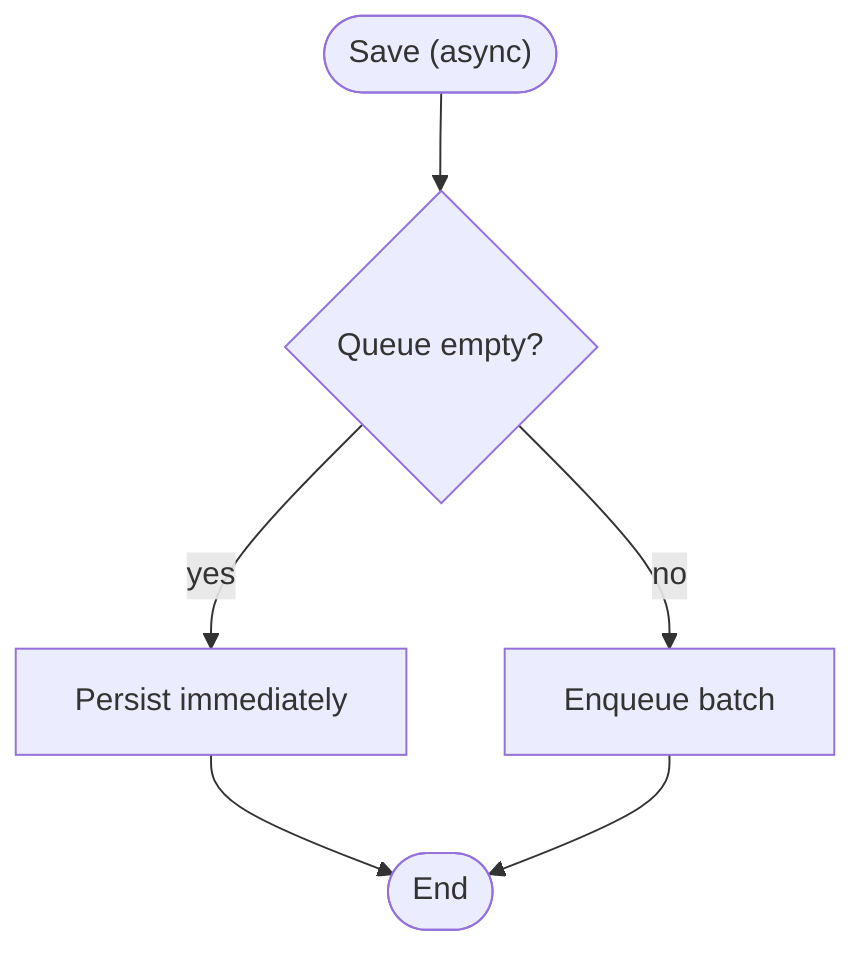

# Example: Fixing Diagrams That Fail to Render

**Scenario**: On a fresh machine with no `mmdc`, a user pastes a sequence diagram and a flowchart drafted elsewhere. Neither renders cleanly, and the user wants them fixed before the doc is saved.

**Applies** **ensure-mermaid-cli** and **validate-diagram-syntax**.

---

## Input

> "These two diagrams were written by a colleague. The sequence one shows nothing after the first message,
> and the flowchart breaks at the `Save (async)` box. Please fix them without changing the story."

## ensure-mermaid-cli

### Step 0 — detect, ask, install

```
$ mmdc --version
command not found
```

> `mmdc` is not installed. It needs Node plus a ~300 MB Chromium download.
> 1. I install it now: `npm i -g @mermaid-js/mermaid-cli`
> 2. You run that command yourself
> 3. I use `npx -p @mermaid-js/mermaid-cli mmdc` for this run only

*User chooses option 1.*

```
$ npm i -g @mermaid-js/mermaid-cli
$ mmdc --version
11.4.2
$ printf 'flowchart TD\n    A([Start]) --> B([End])\n' | mmdc -i - -o /tmp/probe.svg
```

The probe renders silently and exits 0, so validation can proceed.

## validate-diagram-syntax

### Step 1 — list the blocks

```
$ python3 scripts/mermaid_blocks.py list docs/integration.md
 1  docs/integration.md:8   sequenceDiagram  (7 unit(s))  -  #8f2c1d44
 2  docs/integration.md:26  flowchart  (5 unit(s))  -  #c41a90be
```

### Step 2 — render each block

```
$ python3 scripts/mermaid_blocks.py extract docs/integration.md --hash 8f2c1d44 --out /tmp/int-1.mmd
$ mmdc -i /tmp/int-1.mmd -o /tmp/int-1.svg
Error: Parse error on line 12: unexpected ';'
```

```
$ python3 scripts/mermaid_blocks.py extract docs/integration.md --hash c41a90be --out /tmp/int-2.mmd
$ mmdc -i /tmp/int-2.mmd -o /tmp/int-2.svg
Error: Parse error on line 2: unexpected '('
```

### Step 3 — fix each parse error

| Error | Fix applied |
|---|---|
| Line 12: `;` | Reworded `POST /orders; retries 3x` → `POST /orders (3 retries)` |
| Line 2: `(` | Quoted the node: `A[Save (async)]` → `A["Save (async)"]` |

### Step 4 — pre-flight a pasted block

`mmdc` reads stdin with `-i -`, so no temp file is needed to check a block before it lands in a doc.

```
$ printf 'flowchart TD\n    A[Save (async)] --> B\n' | mmdc -i - -o /tmp/check.svg
Error: Parse error on line 2: unexpected '('

$ printf 'flowchart TD\n    A["Save (async)"] --> B\n' | mmdc -i - -o /tmp/check.svg && echo ok
ok
```

### Step 5 — re-render both blocks

```
$ mmdc -i /tmp/int-1.mmd -o /tmp/int-1.svg \
    && mmdc -i /tmp/int-2.mmd -o /tmp/int-2.svg \
    && echo "2 of 2 parsed"
2 of 2 parsed
```

### Step 6 — check what the parser cannot

| Check | Finding | Fix |
|---|---|---|
| Zoom level | No `%% Level:` declaration | Added `%% Level: container — cross-system flow` |
| Branch labels | Every decision edge must name its condition | Labelled `yes` / `no` |

## Corrected blocks





## Step 7 — report

> 2 blocks rendered, 2 parse errors fixed, 2 house-rule issues resolved; 0 failures remain.
