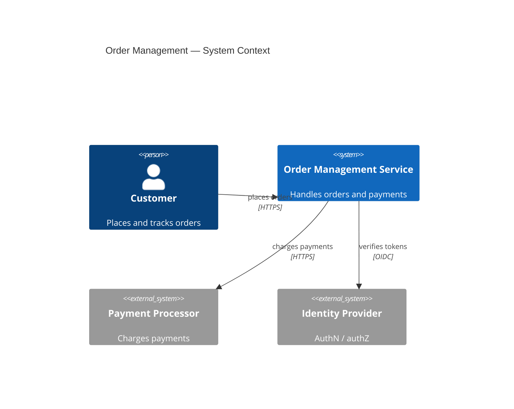
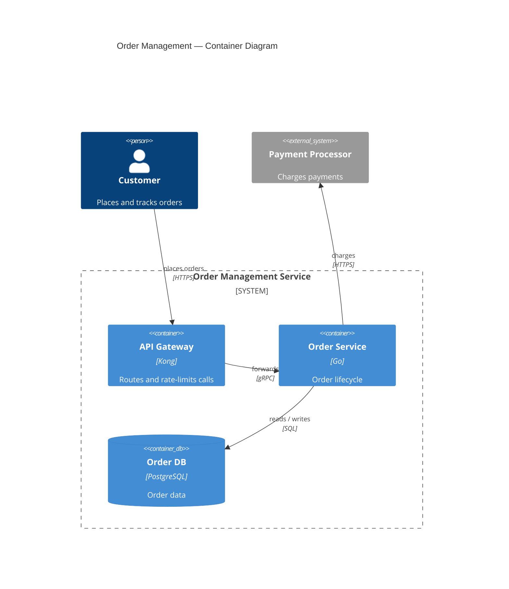
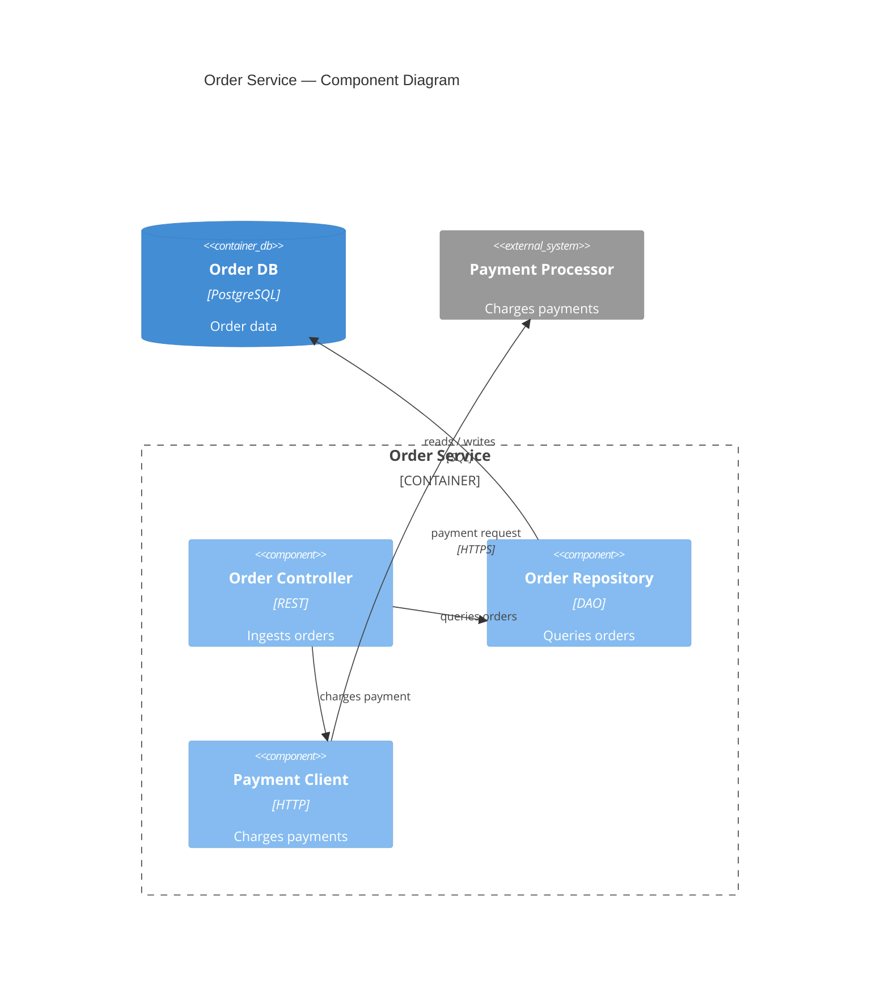

# C4 Syntax

Used by **author-mermaid-diagram** for `C4Context`, `C4Container`, and `C4Component`.

## Element table

| Element | Syntax | Example |
|---|---|---|
| Person | `Person(alias, "Label", "Descr")` | `Person(customer, "Customer", "Places orders")` |
| External person | `Person_Ext(alias, "Label", "Descr")` | `Person_Ext(caller, "Caller", "Calls the API")` |
| System in scope | `System(alias, "Label", "Descr")` | `System(oms, "Order Service", "Handles orders")` |
| External system | `System_Ext(alias, "Label", "Descr")` | `System_Ext(ps, "Stripe", "Charges payments")` |
| System database | `SystemDb(alias, "Label", "Descr")` | `SystemDb(db, "Order DB", "Stores orders")` |
| System queue | `SystemQueue(alias, "Label", "Descr")` | `SystemQueue(q, "Events", "Order events")` |
| Container | `Container(alias, "Label", "Tech", "Descr")` | `Container(api, "API Gateway", "Go", "Routes calls")` |
| Container database | `ContainerDb(alias, "Label", "Tech", "Descr")` | `ContainerDb(db, "Order DB", "PostgreSQL", "Orders")` |
| Container queue | `ContainerQueue(alias, "Label", "Tech", "Descr")` | `ContainerQueue(q, "Events", "Kafka", "Order events")` |
| Component | `Component(alias, "Label", "Tech", "Descr")` | `Component(oc, "Order Controller", "REST", "Ingests")` |
| System boundary | `System_Boundary(alias, "Label") { ... }` | `System_Boundary(oms, "Order Service") { ... }` |
| Container boundary | `Container_Boundary(alias, "Label") { ... }` | `Container_Boundary(api, "API Gateway") { ... }` |
| Relationship | `Rel(from, to, "Label", "Tech")` | `Rel(customer, oms, "places orders", "HTTPS")` |
| Bidirectional | `BiRel(from, to, "Label", "Tech")` | `BiRel(a, b, "syncs")` |

## Level rules

| Level | Center | Contains | Excludes |
|---|---|---|---|
| C1 context | Systems in scope | People, systems, external dependencies | Containers, components, databases |
| C2 container | One system | Apps, services, stores inside the boundary | Internal components |
| C3 component | One container | Components inside the boundary | Other systems' internals |

- Mark every external element with `_Ext`; do not fake externals with dashed styles.
- Place actors left, the system in scope center, external systems right.
- Show only direct relationships at the chosen level; no message-level detail in C4.
- Label each `Rel` with what flows and its protocol: `Rel(api, svc, "forwards", "gRPC")`.
- Scope a C2 or C3 diagram to one system boundary; a wider view belongs to a higher level.
- Use `UpdateLayoutConfig(...)` to tune spacing and `UpdateRelStyle(...)` to nudge labels only when the layout is unreadable.
- C4 is experimental in Mermaid; if rendering fails, simplify syntax before dropping the diagram.

## Example — C1 context

## Example — C2 container

## Example — C3 component

## Failure modes

- `@startuml` / `@enduml` pasted from PlantUML — drop both and start with the C4 type.
- Context diagram holding containers or components — move them into C2 or C3.
- `Rel` without a label, or labels like "uses" that name no flow.
- External systems declared as `System` — readers cannot tell scope.
- Alias reused across elements, which silently merges two boxes.
