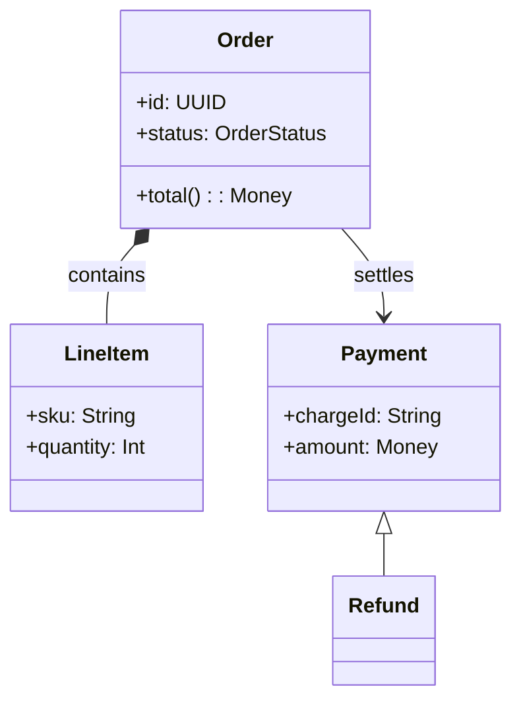
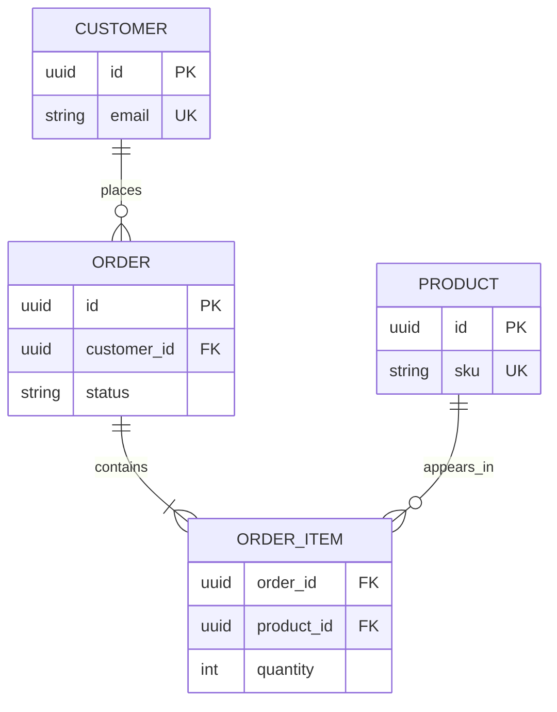

# Data Model Syntax

Used by **author-mermaid-diagram** for `classDiagram` and `erDiagram`.

## Class or ER

| Question | Draw |
|---|---|
| What types exist, how do they relate, inherit, or compose? | `classDiagram` |
| What is persisted, with keys and cardinality? | `erDiagram` |
| Both code structure and storage layout matter | Two diagrams, linked by the same entity names |

## Class diagram

| Element | Syntax | Notes |
|---|---|---|
| Class | `class Order` or `class Order { ... }` | Name in domain language |
| Attribute | `+id: UUID` | `+` public, `-` private, `#` protected |
| Method | `+total(): Money` | Signature only, no bodies |
| Inheritance | `Base <|-- Sub` | Arrow points at the base |
| Composition | `Order *-- LineItem` | Filled diamond: child dies with parent |
| Aggregation | `Cart o-- Item` | Hollow diamond: child outlives parent |
| Association | `Customer --> Order` | Plain arrow |
| Dependency | `Service ..> Repo` | Dashed arrow |
| Label | `Order --> Payment : settles` | Label every association |

Rules:

- Show attributes only when they carry the message; otherwise class names and edges suffice.
- Label every association with the role or action it represents.
- Keep method signatures to the ones the reader must see; no getters, setters, or constructors.
- Mark external or legacy types with a stereotype (`<<external>>`) instead of a different shape.

## ER diagram

| Element | Syntax | Notes |
|---|---|---|
| Entity | `CUSTOMER { ... }` | Singular noun, upper snake case |
| Attribute | `uuid id PK` | `type name [PK|FK|UK] "comment"` |
| One-to-many | `CUSTOMER ||--o{ ORDER : places` | One customer, zero or more orders |
| One-to-one | `ORDER ||--|| INVOICE : has` | Exactly one each side |
| Many-to-many | `ORDER }o--o{ PRODUCT : contains` | Resolve with a join table when it carries data |
| Optional side | `o` | Zero or one |
| Mandatory side | `|` | Exactly one |
| Many side | `{` / `}` | Zero or more / one or more |

Cardinality reads left to right: `A ||--o{ B` means one A relates to zero-or-many B.

Rules:

- Label every relationship with the verb that connects the entities (`places`, `contains`, `settles`).
- Mark `PK` on the identifier and `FK` on every foreign key.
- Name entities in the singular; join tables carry both entity names (`ORDER_PRODUCT`).
- Show only the attributes the question needs — not the full schema.
- Resolve a many-to-many with a join table as soon as it carries attributes.

## Failure modes

- Class diagram drawn as a schema dump: every column of every table, no message.
- Unlabeled associations or relationships, which hide the verb and the cardinality.
- `classDiagram` without any relationship lines — a list of boxes, not a model.
- Many-to-many edges where a join table carries data; the attributes vanish.
- Mixed levels: domain classes next to physical tables in one diagram.
