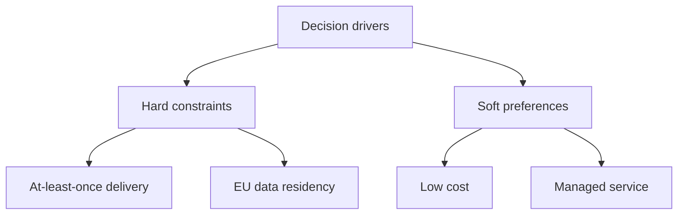
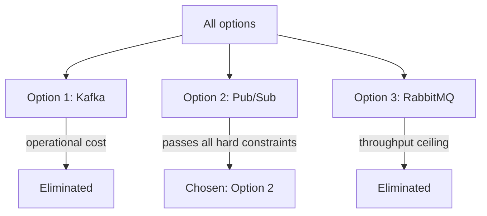

# Decision Diagram Patterns

Used by **author-mermaid-diagram** in decision records: driver map, comparison matrix, elimination tree.

## Selection

| Question | Artifact |
|---|---|
| Which drivers shape the decision, and which are knock-outs? | Driver map (flowchart) |
| How does each option score against each driver? | Comparison matrix (table) |
| Why was each rejected option dropped? | Elimination tree (flowchart) |

Draw the matrix first when options are already evaluated; draw the map first when drivers are still being negotiated.

## Driver map

A two-branch tree separating hard constraints from soft preferences.

- Root: `Decision drivers`.
- Branch 1: `Hard constraints` — every knock-out driver.
- Branch 2: `Soft preferences` — every nice-to-have driver.
- No terminals, no decisions; a tree has a root and leaves only.
- Add a driver by adding a leaf, not a new branch.

## Comparison matrix

A drivers × options table with three visual states.

| State | Meaning |
|---|---|
| ✅ | Satisfies the driver |
| ⚠️ | Partially satisfies, or satisfies under conditions |
| ❌ | Fails the driver — a knock-out |

- Rows are drivers, columns are options, labelled `Option N: <name>`.
- Put hard constraints above soft preferences in the row order.
- Add one sentence under the table naming the winning driver set.

## Elimination tree

A flowchart explaining why each option left the race.

- Root: all considered options.
- Rejected option → edge labelled with the failing driver → `Eliminated`.
- Chosen option → edge `passes all hard constraints` → `Chosen: Option N`.
- One node per option; never merge two eliminations into one edge.

## Consistency rules

- Option labels match the matrix, the tree, and the document headings exactly.
- Every ❌ in the matrix appears as an elimination edge; every elimination edge traces to a ❌.
- Every ✅ driver of the chosen option appears on its `passes all hard constraints` path.
- The tree and the matrix never disagree about an option's verdict.
