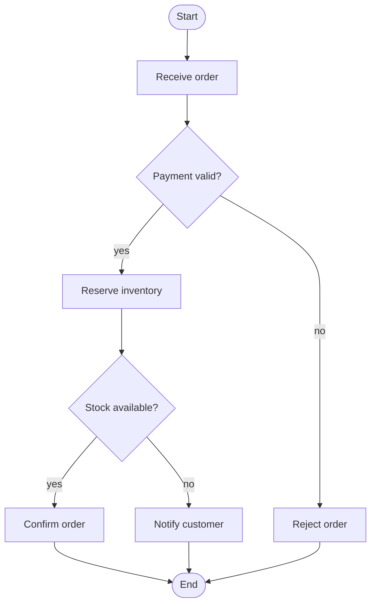
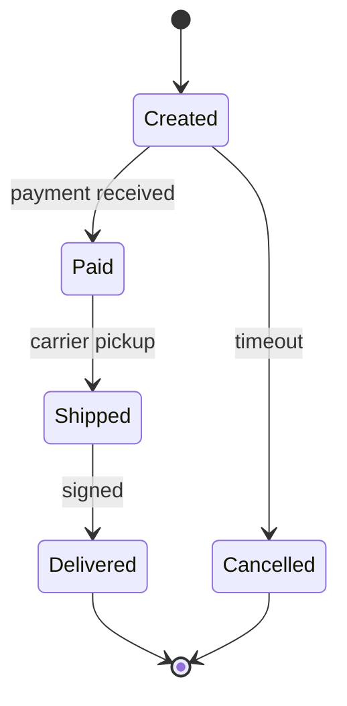

# Flowchart and State Syntax

Used by **author-mermaid-diagram** for `flowchart` and `stateDiagram-v2`.

## Flowchart elements

| Element | Syntax | Notes |
|---|---|---|
| Start / end | `A([Start])` | Stadium shape |
| Process step | `B[Receive order]` | Rectangle |
| Decision | `C{Payment valid?}` | Diamond |
| Branch | `C -->|yes| D` | Label every branch |
| Grouping | `subgraph owner ... end` | One subgraph per owner or phase |
| Link | `A --> B` | Arrow direction = flow direction |
| Style | `style A fill:#e8f0fe` | Optional, sparingly |

## Flowchart rules

- Start and end every process flowchart with a stadium node.
- Use short imperative labels: `Validate order`, not "The order is validated by the system".
- Label every branch of a decision node with the condition (`yes` / `no` / `timeout`).
- Keep one direction (`TD` top-down, `LR` left-to-right); mixing reads as two flows.
- Use `subgraph` for ownership or phase boundaries, never for decoration.
- Skip terminal nodes in tree-shaped diagrams (driver map, elimination tree) — they have a root, not a process.

## State elements

| Element | Syntax | Notes |
|---|---|---|
| Start / end | `[*] --> Created`, `Done --> [*]` | Pseudo-state |
| State | `Created --> Paid: payment received` | Label is the trigger |
| Choice | `state Paid <<choice>>` | Use only when a guard decides the next state |
| Nested state | `state Processing { ... }` | Nest only when the inner states matter |

## When to draw which

| Question | Draw |
|---|---|
| What steps run, and which decisions branch? | `flowchart` |
| What states exist, and what triggers each move? | `stateDiagram-v2` |
| Both process steps and state names matter | Flowchart, naming states as steps |
| A lifecycle with guards inside a state | `stateDiagram-v2` with a choice |

## Example — flowchart with decisions

## Example — state lifecycle

## Failure modes

- Unlabeled decision branches, which hide the condition a reader needs.
- Sentence-length process labels; the shape already says "process".
- A state diagram carrying decision logic — move the branches to a flowchart.
- A flowchart modeling a pure lifecycle — states read better than boxes.
