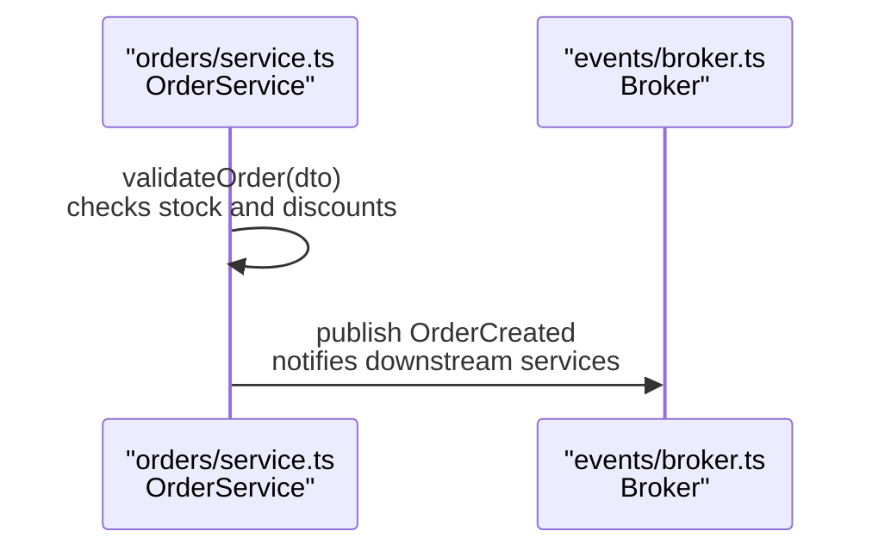
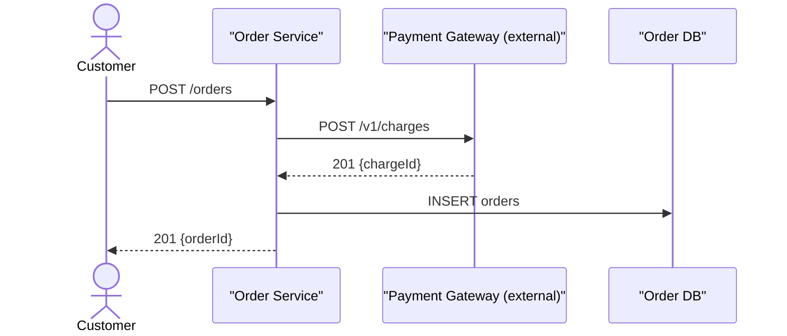
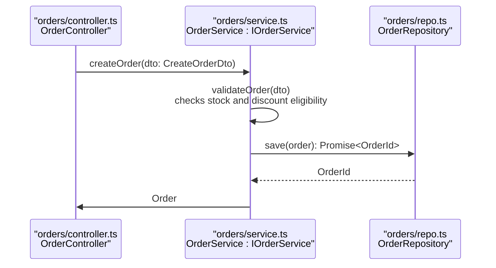

# Sequence Syntax

Used by **author-mermaid-diagram** for `sequenceDiagram`.

## Syntax quick reference

- `actor Name` — human or external system
- `participant Name as Alias` — service, store, module, or class lifeline
- `->>` sync request · `-)` async message · `-->>` return only
- `activate` / `deactivate` — activation bars, used sparingly
- `Note left of A`, `Note right of A`, `Note over A,B` — annotations
- `alt` / `else` / `end`, `loop` / `end`, `par` / `and` / `end` — blocks
- ` ` — line break inside a label; `%%` — comment

## Zoom level (hard rule)

Every diagram operates at exactly one level; a service never shares a canvas with a class.

| Level | Lifelines are | Messages are | Use when |
|---|---|---|---|
| Container | Services / systems | API endpoints, events, protocols | Runtime flow across systems |
| Component | Modules / interfaces | Method calls | Flow across modules |
| Code | Files / classes | Method signatures | Flow across files or classes |

- Declare the level in a `%%` comment and in the takeaway line: `%% Level: code — cross-file / class`.
- Name the level in words, not jargon: "cross-system", "cross-module", "cross-file / class".

## Participant identity

A lifeline label encodes its identity path so the reader knows which system, file, or class it is.

| Level | Declaration |
|---|---|
| Cross-system | `participant OMS as "Order Service"` |
| Cross-module | `participant OC as "orders/controller.ts OrderController"` |
| Cross-file / class | `participant OR as "orders/repo.ts OrderRepository : IOrderRepository"` |

- Include the file path at component and code level — it is the fastest route to the code.
- Show the interface after the class (`: IOrderService`) when a role is defined by one.
- Group ownership with an alias prefix per system (`OMS_Controller`) — sequence diagrams have no boundary boxes.
- Use `actor` for humans and external callers, `participant` for services, stores, and classes.
- Mermaid has no `database` lifeline keyword; declare stores as `participant`.

## Messages are the contract

A message label carries the real API, event, or signature — never prose.

| Level | Good label | Bad label |
|---|---|---|
| Cross-system | `POST /orders`, `gRPC ReserveStock`, `publish OrderCreated (Kafka: orders)` | "sends order request" |
| Code | `createOrder(dto: CreateOrderDto): Promise<Order>` | "calls create" |

- `->>` sync request · `-)` async / fire-and-forget · `-->>` return or reply only.
- Never use `-->>` for an async message; it reads as a reply.
- Show a return only when the next step needs its data; no return → return chains.
- Reword or split any message containing `;` — Mermaid treats it as a statement separator.

## Events and self-calls

Append a short effect after the call, separated by ` `, when the name alone hides the intent.

- Show a self-call only when the internal step belongs to the story.
- Larger internal logic moves to a `Note over` or its own flowchart.

## Message completeness

- Include every message and return the flow requires; no more, no less.
- Use `alt`, `loop`, or `par` only where the branch changes the story.
- Skip activation bars unless call nesting matters.

## Example — container level

## Example — code level

## Failure modes

- Mixed levels: a service and a class on one canvas.
- Prose messages instead of endpoints, events, or signatures.
- Lifelines from two zoom levels on one canvas.
- `;` inside a message or `Note`, which truncates the diagram at parse time.
- Activation bars on every call, adding visual noise with no meaning.
