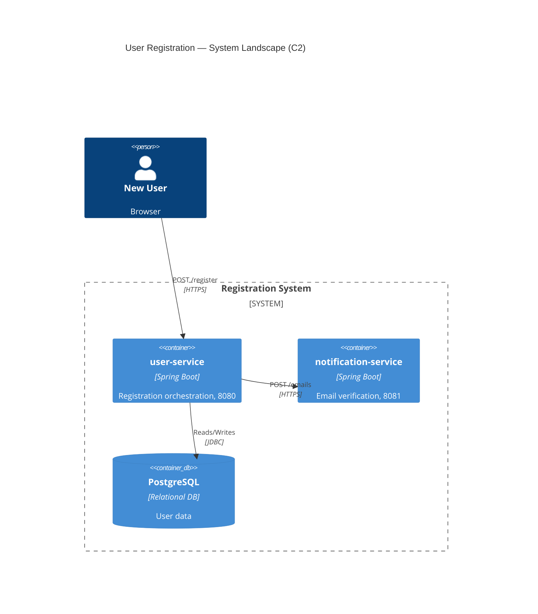
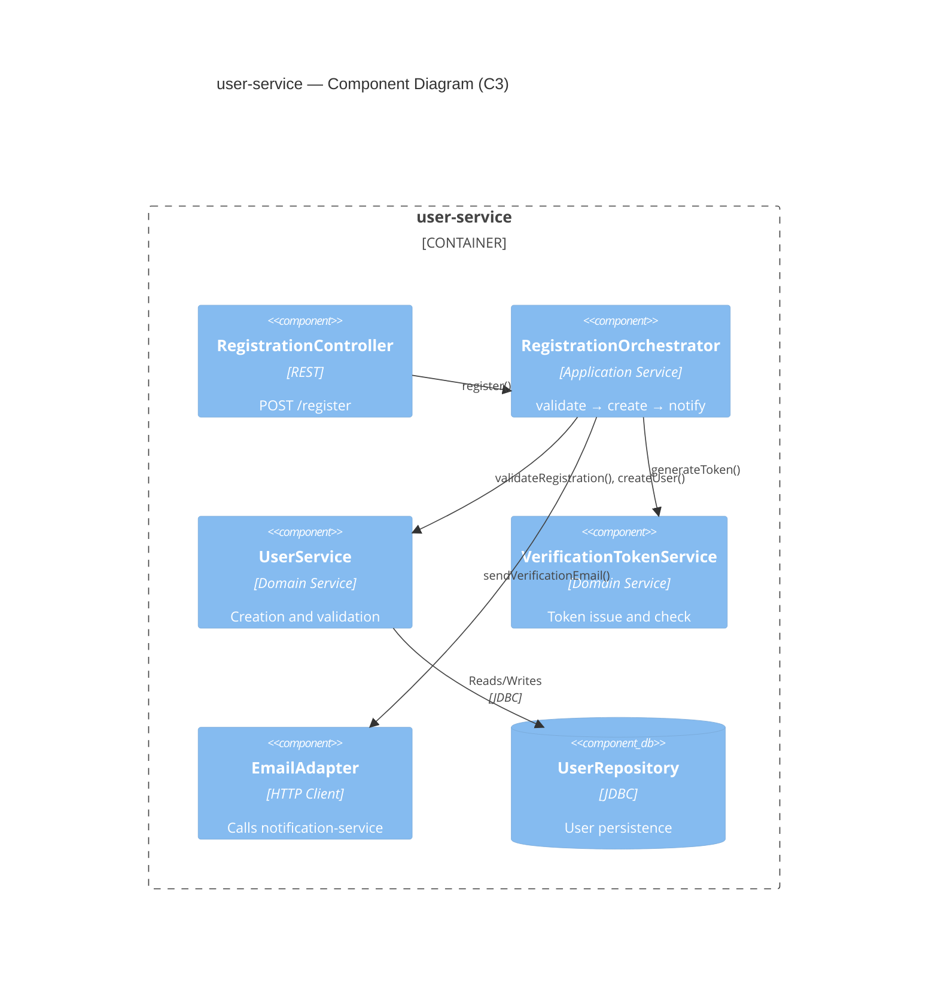
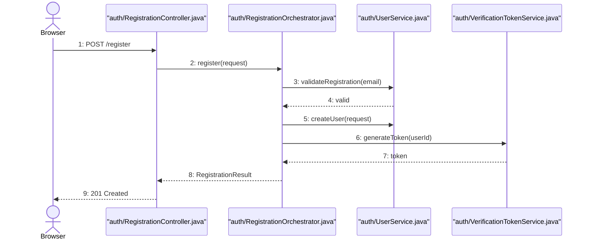

# Example: Full Markdown Report Output

## User Request

"Please investigate the user registration flow and output all findings in a markdown document."

## Response: Markdown Report

Applies `<compile-markdown-report>`.

```markdown
# Investigation Report: User Registration Flow

> **Date**: 2026-07-21
> **Scope**: `user-service`, `notification-service` (2 repositories)
> **Flow**: User registration end-to-end

## 1. System Overview (C2)

| Repository | Description | Port | Language |
|---|---|---|---|
| `user-service` | Registration orchestration | 8080 | Spring Boot / Java 17 |
| `notification-service` | Email verification, welcome mail | 8081 | Spring Boot / Java 17 |

| Source | Target | Protocol | Direction | Details |
|---|---|---|---|---|
| `user-service` | `notification-service` | HTTP REST (`POST /emails`) | Outbound | Sends verification email |
| `user-service` | PostgreSQL (`user-db`) | JDBC | Read/Write | Stores user data |
| `notification-service` | PostgreSQL (`notification-db`) | JDBC | Read/Write | Tracks email status |



## 2. Component Internals (C3)



## 3. Interaction Flow — Registration



Email notification is the second concern: `RegistrationOrchestrator` → `EmailAdapter.sendVerificationEmail()` → `POST /emails` `[cross-repo → notification-service]` → `EmailSent`.

## 4. Method Details — `RegistrationOrchestrator.register()`

```
[1] RegistrationOrchestrator.register(request: RegistrationRequest)
  File: user-service/src/main/java/.../RegistrationOrchestrator.java:28
  Parameters: request={email="user@example.com", name="John"}
  Returns: RegistrationResult(userId=42, status=VERIFICATION_PENDING)
  Code:
  │  28: public RegistrationResult register(RegistrationRequest request) {
  │  29:     userService.validateRegistration(request.getEmail());
  │  30:     User user = userService.createUser(request);
  │  31:     VerificationToken token = verificationTokenService.generateToken(user.getId());
  │  32:     emailAdapter.sendVerificationEmail(user.getEmail(), token);
  │  33:     return new RegistrationResult(user.getId(), Status.VERIFICATION_PENDING);
  ├─→ [2] UserService.validateRegistration(email) — throws DuplicateEmailException
  ├─→ [3] UserService.createUser(request) — UserRepository.save()
  ├─→ [4] VerificationTokenService.generateToken(userId) — 24h expiry
  ╰─→ [5] EmailAdapter.sendVerificationEmail(email, token) — HTTP POST /emails

[2] UserService.validateRegistration(email: String)
  File: .../UserService.java:45
  Code:
  │  45: public void validateRegistration(String email) {
  │  46:     if (userRepository.existsByEmail(email)) {
  │  47:         throw new DuplicateEmailException("Email already registered");
```

Remaining frames `[3]`–`[5]` follow the same format (abridged here).

## 5. Key Design Decisions

| Decision | Rationale | Trade-off |
|---|---|---|
| Async email verification | User can close the browser | Extra pending/verified state |
| Token with 24h expiry | Security default | Resend path needed |
| Separate notification-service | Independent scaling | Extra network hop |
| REST between services | Simple at low volume | Synchronous coupling |

## 6. Edge Cases

- **Duplicate email** — `UserService.validateRegistration()` throws `DuplicateEmailException`.
- **Email delivery failure** — `EmailAdapter` retries with backoff; user stays `VERIFICATION_PENDING`.
- **Token expiry** — verification returns `410 GONE`; a new token can be issued.
- **Race on email** — unique index on `users.email`.

## 7. Confidence & Coverage

- ✅ Verified: orchestration chain `RegistrationOrchestrator.java:28-33`; duplicate check `UserService.java:45-48`; token expiry `VerificationTokenService.java:22-25`
- ✅ Verified: email send over REST `EmailAdapter.java:33-38`
- 🔶 Inferred: retry count 3 — catch block read, config not opened
- 💭 Assumptions: `notification-service` port 8081 taken from docker-compose
- ❓ Gaps: account-closure flow not traced; SMTP config in `notification-service` not examined
- ⚠️ Inconsistencies: `README.md` says 5 retries, `EmailAdapter.java` shows 3

## 8. Next Steps

- [ ] Read `VerificationTokenService` for expiry cleanup
- [ ] Check `notification-service` template rendering and SMTP
- [ ] Review rate limiting on `POST /register`
```

Sections 1–2 come from `<analyze-cross-repo-dependencies>` and `<draw-c4-diagram>`, 3 from `<draw-sequence-diagram>`, 4 from `<trace-call-stack>`, 7 from `<present-findings-with-confidence>`.
