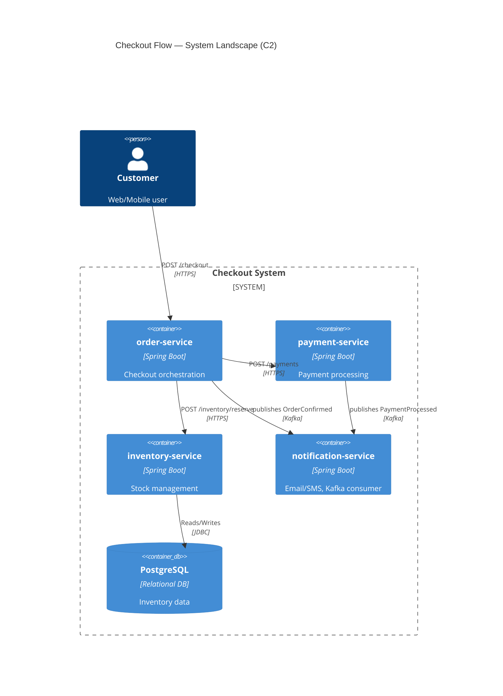
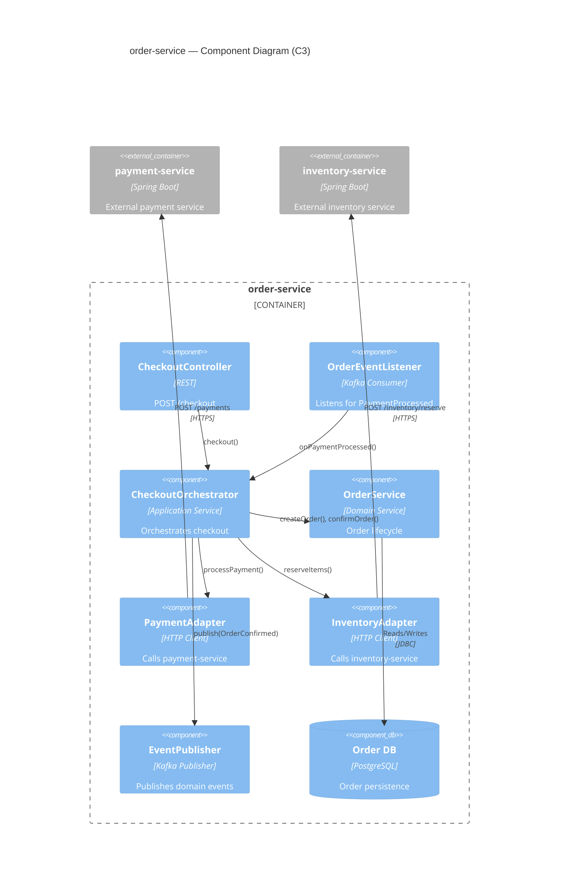
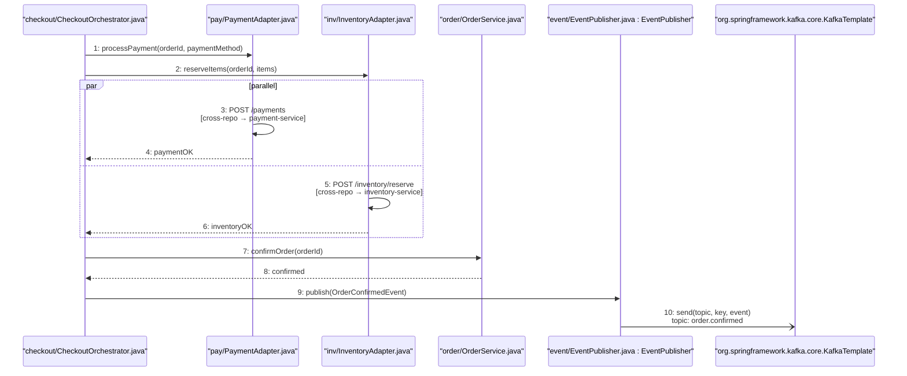

# Example: Progressive Zoom-in — Checkout Flow

## User Request

"I want to fully understand how the checkout flow works, from the API call to the confirmation. Please show me all levels."

## Response

### Level 1: C2 Container Diagram (System Landscape)

Applies `<draw-c4-diagram>` (C2).



---

### Level 2: C3 Component Diagram (order-service Internals)

Applies `<draw-c4-diagram>` (C3).



`CheckoutOrchestrator` owns the flow; `PaymentAdapter` retries with a circuit breaker, `InventoryAdapter` fails fast on timeout.

---

### Level 3: Sequence Diagram — Checkout Flow

Applies `<draw-sequence-diagram>`. The flow carries two concerns, so it is split into two code-level diagrams.

**Order creation** (4 messages, shown here as prose to keep the example short): `POST /checkout` → `checkout(request)` → `createOrder(customerId, items)` → `Order`.

**Parallel fulfillment, confirm, publish**:



---

### Level 4: Call Stack Trace — `CheckoutOrchestrator.checkout()`

Applies `<trace-call-stack>`.

```
[1] CheckoutOrchestrator.checkout(request: CheckoutRequest)
  File: order-service/src/main/java/.../CheckoutOrchestrator.java:35
  Parameters: request={customerId="CUST-001", items=[...], paymentMethod="CREDIT_CARD"}
  Returns: OrderSummary (JSON)
  Code:
  │  35: public OrderSummary checkout(CheckoutRequest request) {
  │  36:     Order order = orderService.createOrder(request.getCustomerId(), request.getItems());
  │  37:
  │  38:     PaymentResult payment = paymentAdapter.processPayment(order.getId(), request.getPaymentMethod());
  │  39:     InventoryResult inventory = inventoryAdapter.reserveItems(order.getId(), request.getItems());
  │  40:
  │  41:     orderService.confirmOrder(order.getId());
  │  42:     eventPublisher.publish(new OrderConfirmedEvent(order.getId()));
  │  43:     return new OrderSummary(order, payment, inventory);
  ├─→ [2] OrderService.createOrder(customerId, items)
  ├─→ [3] PaymentAdapter.processPayment(orderId, paymentMethod)   [async, parallel]
  ├─→ [4] InventoryAdapter.reserveItems(orderId, items)           [async, parallel]
  ├─→ [5] OrderService.confirmOrder(orderId)
  ╰─→ [6] EventPublisher.publish(event)

[2] OrderService.createOrder(customerId: String, items: List<Item>)
  File: order-service/src/main/java/.../OrderService.java:52
  Parameters: customerId="CUST-001", items=[Item(id="SKU-001", qty=2)]
  Returns: Order(id="ORD-12345", status=PENDING)
  Code:
  │  52: public Order createOrder(String customerId, List<Item> items) {
  │  53:     Order order = new Order(customerId, items);
  │  54:     order.setStatus(OrderStatus.PENDING);
  │  55:     return orderRepository.save(order);
  ├─→ [2a] OrderRepository.save(order) — INSERT INTO orders

[3] PaymentAdapter.processPayment(orderId: String, paymentMethod: String)
  File: order-service/src/main/java/.../PaymentAdapter.java:67
  Returns: PaymentResult(status=SUCCESS, transactionId="TXN-001")
  ╰─→ HTTP POST http://payment-service/api/payments [cross-repo]
```

Frames `[4]`–`[6]` are abridged: `InventoryAdapter` posts to `inventory-service`, `confirmOrder` flips status to `CONFIRMED`, and `EventPublisher` sends to `order.confirmed`.

**Untraced branches (❓ Gap)**: payment failure path, inventory rollback, and `OrderEventListener.onPaymentProcessed()`.

The four levels compile into one document via `<compile-markdown-report>`.
